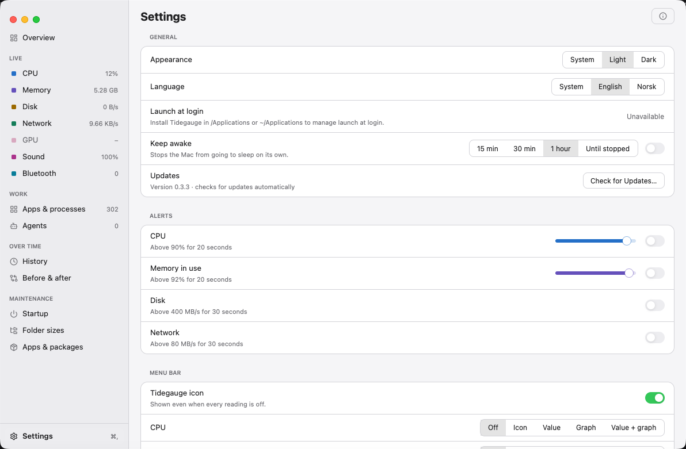
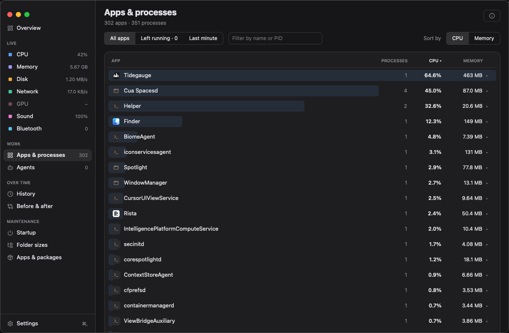

<p align="center">
  
</p>

# Tidegauge

A menu-bar system monitor for macOS, written in Rust with [gpui-kit](https://crates.io/crates/gpui-kit). Tidegauge groups processes by their owning app and presents system activity in a compact panel.

## Install

Download a release DMG, open it, and drag `Tidegauge.app` onto the `Applications`
shortcut. Launch Tidegauge from Applications. The release DMG is signed and
notarized; a locally generated image is not automatically notarized.


Overview in Tidegauge 0.3.3, dark appearance, captured on a virtual Mac. The
virtual Mac has no battery and no readable GPU usage, so those read as
unavailable; readings describe that environment, not physical hardware.

| Light appearance | Dark appearance |
|---|---|
|  |  |
|  |  |

The [screenshot archive](assets/README.md#screenshot-archive) records how each
capture was made.

## Project status

See the [changelog](CHANGELOG.md) for published releases and unreleased changes,
including work still in review. Repository features are not necessarily present
in the latest downloadable release.

Tidegauge is an early development build. This repository contains the app source and recovered development notes. Some controls remain incomplete, while local `.app` packaging and a fail-closed production release helper are available. Production signing and notarization require the credentials described in [Releasing](docs/RELEASING.md). Collector regression tests cover the fixes described in [CONTRIBUTING](CONTRIBUTING.md). See the limitations below before relying on a metric or action.

## Build and run

Requirements:

- macOS. The app uses Mach, libproc, IOKit, CoreAudio, and AppKit directly.
- A Rust toolchain with Cargo and the macOS developer tools installed.
- The macOS utilities `lsof`, `nettop`, `system_profiler`, `route`, and `osascript` available to the process.

Run a development build from the repository root:

```sh
cargo run
```

For an optimized build:

```sh
cargo build --release
./target/release/tidegauge
```

The app opens a resizable window and adds one item to the menu bar. It runs without a Dock icon. A left click on the menu-bar item opens a small panel with live readings, AI plans and the busiest apps, and a button that opens the window; a right or Control click opens a menu with Open Dashboard, Check for Updates, Settings, and Quit. Closing the window hides it while collection continues. The window's sidebar lists every page and ends with Settings. Command-comma also opens Settings, and Command-Q quits while the window is focused. A per-user lock prevents duplicate instances; launching again leaves the existing app running.

Create an ad-hoc preview bundle after the optimized build:

```sh
packaging/package-app.sh preview
```

The packaging modes, signing prerequisites, and required production notarization flow are
documented in [Releasing](docs/RELEASING.md). Production packaging fails closed
when its signing credentials are unavailable.

Create a local drag-and-drop disk image from the same app bundle:

```sh
packaging/create-dmg.sh build/preview/Tidegauge.app build/Tidegauge.dmg
```

The image contains only `Tidegauge.app`, an `Applications` shortcut, and the
committed Finder layout. Only the release pipeline notarizes and staples its
DMG; the helper optionally signs with `DEVELOPER_ID_APPLICATION`.

## What the app contains

| Area | Current implementation |
|---|---|
| Menu bar | One Tidegauge icon by default; optional labeled readings share the same native item |
| Menu-bar panel | Live CPU, memory, network and disk with recent curves, AI plans, the busiest apps, and quick actions |
| Overview | Favorite metric cards, busiest apps, memory and power breakdowns, optional compact layout, and configurable sidebar order |
| Metric pages | CPU, Memory, Disk, Network, GPU, Battery, Sound, Bluetooth, and stored History, each with notes behind ⓘ |
| Agents | Running coding-agent sessions with what they started and Quit, AI plan usage read from OpenQuota's saved data, and development servers |
| Device telemetry | Read-only temperature/fan channels, per-drive capacity/APFS/activity/health, and battery health/charging detail where available |
| App grouping | CPU, memory, disk counters, and processor power grouped by executable bundle or parent app |
| Sound | Default media-output volume/mute controls where the device supports them, plus read-only process audio activity |
| Bluetooth | Connected devices and available battery levels from `system_profiler` |
| Development servers | Shown in Agents: owned development listeners, explicit process/project/port confirmation, signal-time eligibility checks, and asynchronous Stop outcomes |
| History | Local 12-hour, 24-hour, 7-day, and 30-day system/app trends with downsampled averages and visible gaps |
| Alerts | Opt-in CPU, used-memory, disk, network, low startup-disk space and overheating alerts; configurable CPU/memory thresholds and independent cooldowns |
| Keep awake | Native idle-system-sleep prevention for 15 minutes, 30 minutes, 1 hour, or until stopped |
| Apps & processes | Every app with its processes, filter and sort, observed ownership, and confirmed Quit and Force Quit for an app, a process, or what an app left running |
| Language | English or Norwegian Bokmål, following macOS or chosen in Settings |
| Updates | Signed automatic updates, with Check for Updates in Settings, the panel and the menu |
| Tools · Startup | Bounded legacy registration inventory, explicit override evidence, Tidegauge login preference and System Settings handoff |
| Last minute | Apps & processes view of recent per-process CPU, disk I/O and wakeups with observed coverage, not an energy score |
| Tools · Compare | Frozen 5-, 15- or 30-minute system summaries and equal-length, non-overlapping comparisons |
| Tools · Storage | Cancellable metadata-only selected-folder scan, allocated/logical sizes, largest files and Reveal in Finder |
| Tools · Apps & Packages | Explicit source-filtered app/package inventory and single-item package-manager actions where ownership can be verified |

## Current limitations

- Project Stop rechecks ownership, start time, project eligibility, and a confirmed listening port. It requests termination with SIGTERM and reports whether the original process exited; it never escalates to force-kill. As with any PID-based API, validation and signaling are not an atomic operation.
- Process signing metadata is fetched only on request and is not signature validation or a safety verdict. It never changes Quit/Stop eligibility. See [process semantics](docs/PROCESSES.md).
- Sound controls apply to the default **media output**, not individual apps or the microphone. Unsupported device controls are unavailable. Per-app volume, mute, and signal meters remain deferred; no audio is captured. See [audio capabilities](docs/AUDIO.md).
- Neural Engine usage is not measured. GPU and battery detail depend on hardware and available system properties. Per-app watts are the processor energy macOS accounts to each process (Apple silicon), from its energy model rather than a meter. GPU, display, radio and work done by system processes on an app's behalf are not included, so graphics-heavy apps read low.
- Alerts default to **off**, including when older settings are migrated. Enable each category in Settings. CPU/memory must exceed the chosen threshold for 20 seconds; disk/network for 30 seconds; startup-disk space must stay under 10 GB free for a minute; overheating fires when macOS reports a serious or critical thermal state for 10 seconds. An episode alerts only once until recovery, with a separate ten-minute cooldown for each category. Notification permission, Focus, and macOS notification settings still govern delivery.
- Launch at login is
  available on macOS 13+ only for a bundle installed in `/Applications` or
  `~/Applications`; approval may be required in System Settings > General >
  Login Items. Closing the dashboard hides it while collection continues.
- Live module charts show the current session; the History tab reads persisted SQLite data off the UI thread. Retention targets 30 days with hourly pruning while running. Legacy placeholders and top-60 app recording have important limitations; see [history semantics](docs/HISTORY.md).
- Keep awake prevents **idle system sleep only**. Displays may sleep, and closing the lid or explicitly sleeping still takes precedence. It releases on expiry, Stop, or app exit and does not resume automatically after restart.
- Dashboard reset affects only tab order, favorites, and compact layout. It does not reset menu-bar readings, appearance, login, or alert preferences. Overview and Settings remain reachable.
- Startup inventory is partial. Modern login/background items are managed through System Settings. Third-party disable, removal and restoration are deliberately unavailable until managed/protected registration eligibility can be established safely; a plist or an absent launchctl override does not establish effective state.
- Resource activity is a recent observed window, not lifetime consumption, watts, an energy-impact score or predicted battery savings. Counter resets, process replacement, missing observations and long gaps reset coverage; wakeups are reported interrupt counters only, and package-idle wakeups remain unavailable.
- Baselines compare system metrics only, require 80% coverage for percentage changes, and never divide by a zero baseline. A saved summary survives History pruning. Power-source/thermal context is not recorded, and differences do not prove causation.
- Storage scans never delete files or calculate guaranteed reclaimable space. APFS sharing and snapshots affect totals. Cloud placeholders, links, other volumes and inaccessible files are skipped. Bounds on entries, recursion and queued directories can produce explicitly partial results.
- Apps & Packages covers detected installations only. Linked packages, missing registry provenance, ambiguous versions and unsupported installer artifacts remain read-only. Manager actions can run lifecycle scripts and change dependencies; they are not atomic and have no automatic rollback. Removal requires a successful command and a complete reread of the same manager source before success is reported. No elevated privileges, forced removal or leftover-data cleanup is used. Application metadata is read from `Contents/Info.plist` with `plutil`; whole-file JSON conversion cannot represent `<data>` or `<date>` values, so a plist containing either falls back to per-key extraction of the bundle name and version. A bundle with no readable Info.plist is reported as a warning rather than silently dropped.

Projects requires a working directory within four levels of a Git root or a recognized manifest (`package.json`, `Cargo.toml`, `pyproject.toml`, `go.mod`, `Gemfile`, or `composer.json`). Known development runtimes and custom executables inside that project qualify. Desktop app bundles, other users' processes, root/home directories, and listeners without a project marker are excluded. Servers launched from unrelated folders will not appear.

## Settings and local data

| Data | macOS location |
|---|---|
| Settings | `~/Library/Application Support/no.ogard.tidegauge/settings.json` |
| History | `~/Library/Application Support/no.ogard.tidegauge/history.db` |
| Saved system baseline | `~/Library/Application Support/no.ogard.tidegauge/system-baseline-v1.json` |
| Cached app icons | `~/Library/Caches/no.ogard.tidegauge/icons/` |

Open Settings from the sidebar, the menu-bar panel, the menu, or Command-comma. Each metric can be Off, Icon, Value, Graph, or Value + graph. Optional readings appear together in one native item, with labels for values and graphs, consistent spacing, and fixed widths for changing values. Changes are saved immediately and applied on the next refresh. Use Reset to icon only to clear extra readings. Existing preferences are preserved on upgrade.

You can hide the Tidegauge icon while a metric is enabled; it stays visible if every metric is Off so Settings and Quit remain reachable. Graphs show a dash until enough samples are available. K/s, M/s, G/s, and T/s are byte rates using powers of 1024.

The app uses defaults when the settings file is absent or cannot be parsed. You can also edit the file directly:

```json
{
  "dark": null,
  "show_app_icon": true,
  "menu_items": [],
  "alert_cpu_pct": 90.0,
  "alert_mem_pct": 92.0,
  "launch_at_login": false
}
```

Available metric identifiers are `cpu`, `memory`, `network`, `disk`, `battery`, `gpu`, and `power`. The menu-bar pump reloads this file while the app runs. Appearance can be set to System, Light, or Dark for the dashboard.

History includes app names and resource usage. The sampler records headline metrics and the first 60 app groups sorted by memory usage approximately every five sampling passes. Sampling starts a new process and chart baseline on each launch; renaming the storage namespace does not migrate older settings or history.

## Architecture

The sampler runs on a background thread. It publishes each completed `Snapshot` for the panel and status-bar pump to read without waiting for the collectors. Per-app network rates persist between network sampling passes. Each pass waits two seconds after its work completes; external utilities can lengthen that interval. Bluetooth collection runs every ten passes, per-app network collection every other pass, and history persistence every five passes.

| File | Responsibility |
|---|---|
| `src/main.rs` | Application entry point, panel creation, status-bar pump |
| `src/instance.rs` | Per-user process lock preventing duplicate monitors |
| `src/app.rs` | Sampler lifecycle, shared panel handle, notifications |
| `src/engine.rs` | Counter deltas, snapshot model, in-memory chart histories |
| `src/ffi.rs` | Raw macOS C API declarations and layouts |
| `src/metrics.rs` | System CPU, memory, disk, network, GPU, battery, and chip collectors |
| `src/processes.rs` | Process enumeration and app grouping |
| `src/projects.rs` | Listening ports, project grouping, idle tracking, per-app network collection |
| `src/audio.rs` | CoreAudio device and process properties |
| `src/bluetooth.rs` | Bluetooth JSON parsing and cache |
| `src/history.rs`, `src/history_browser.rs` | SQLite persistence and read-only range queries |
| `src/baselines.rs`, `src/resource_activity.rs` | Frozen time-weighted summaries and identity-aware recent process activity |
| `src/startup.rs`, `src/packages.rs`, `src/storage.rs` | Bounded inventories and source-specific safety checks |
| `src/tools_panel.rs` | Tools navigation and asynchronous inventory/scan/comparison controls |
| `src/alerts.rs` | Sustained alert thresholds, recovery, and cooldowns |
| `src/keepawake.rs` | Owned native idle-sleep assertions and expiry |
| `src/controls.rs` | Settings, history, keep-awake, and output-device controls |
| `src/settings.rs` | Settings model, defaults, and JSON persistence |
| `src/statusbar.rs` | Native menu-bar items and sparklines |
| `src/ui.rs` | Panel navigation, tab content, and charts |
| `src/theme.rs`, `src/icons.rs` | Design tokens and app-icon caching |

## Development documentation

- [Roadmap and implementation issues](https://github.com/henrikogaard/tidegauge/issues/12): priorities, acceptance criteria, and verification steps.
- [Artwork](assets/README.md): logo files and generation prompt.
- [Contributing](CONTRIBUTING.md): checks, manual verification, and review expectations.
- [Design](DESIGN.md): colors, layout, and menu-bar behavior.
- [Releasing](docs/RELEASING.md): bundle modes, signing prerequisites, and update acceptance.
- [Signing-key recovery](docs/RELEASING.md#signing-key-custody-and-recovery): portable backups, restore checks, and hosting migration.
- [0.1.0 release notes](docs/RELEASE-0.1.0.md): included capabilities and remaining acceptance checks.
- [Recovery manifest](RECOVERY-MANIFEST.md): provenance of the recovered files.
- [Historical findings](tidegauge-findings.md) and [historical test plan](tidegauge-test-plan.md): evidence from an earlier environment, not validation of the current checkout.

## License

Tidegauge is licensed under the [MIT License](LICENSE).

Copyright (c) 2026 Henrik Øgård.
