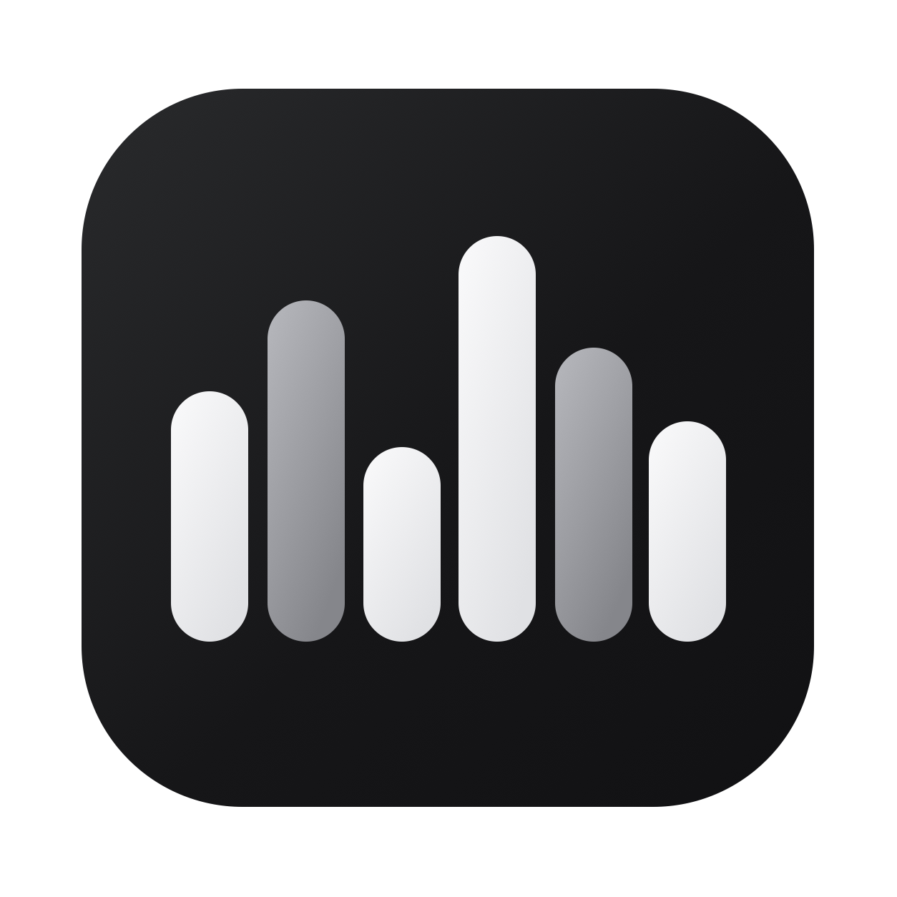
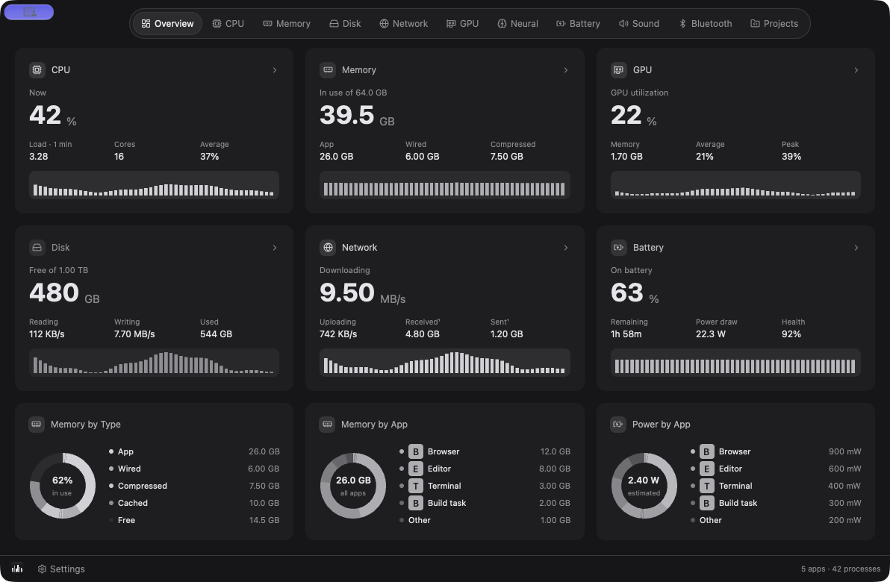
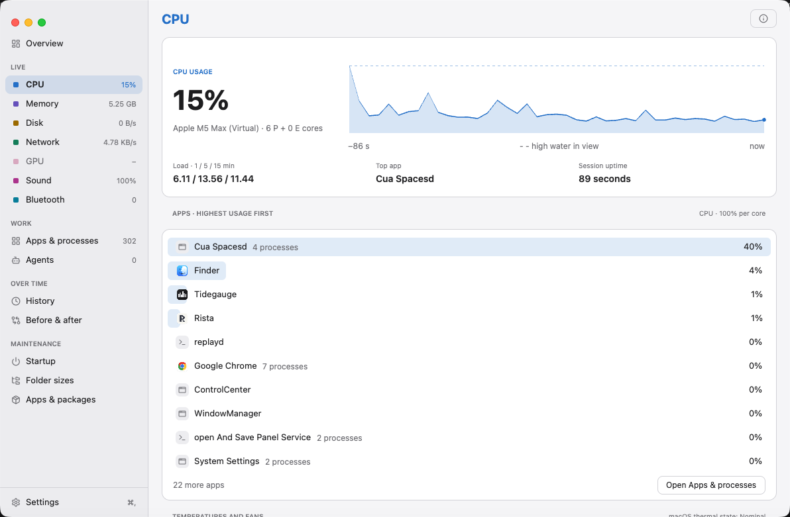
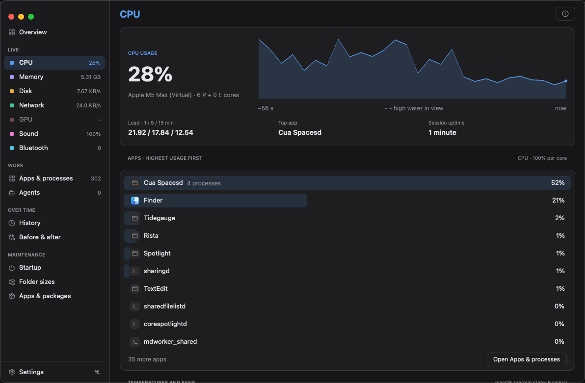

<p align="center">
  
</p>

# Tidegauge

A menu-bar system monitor for macOS, written in Rust with [gpui-kit](https://crates.io/crates/gpui-kit). Tidegauge groups processes by their owning app and presents system activity in a compact panel.

## Install

Download a release DMG, open it, and drag `Tidegauge.app` onto the `Applications`
shortcut. Launch Tidegauge from Applications. The release DMG is signed and
notarized; a locally generated image is not automatically notarized.



Current dashboard in dark appearance, captured on a virtual Mac. Readings
describe that development environment, not physical-hardware validation.

| Light appearance | Dark appearance |
|---|---|
|  |  |

The [screenshot archive](assets/README.md#screenshot-archive) includes capture
provenance, Norwegian layouts, and explicitly labeled hardware fixtures.

## Project status

Tidegauge is an early development build. This repository contains the app source and recovered development notes. Some controls remain incomplete, while local `.app` packaging and a fail-closed production release helper are available. Production signing and notarization require the credentials described in [Releasing](docs/RELEASING.md). Collector regression tests cover the fixes described in [CONTRIBUTING](CONTRIBUTING.md). See the limitations below before relying on a metric or action.

## Build and run

Requirements:

- macOS. The app uses Mach, libproc, IOKit, CoreAudio, and AppKit directly.
- A Rust toolchain with Cargo and the macOS developer tools installed.
- The macOS utilities `lsof`, `nettop`, `system_profiler`, `route`, and `osascript` available to the process.

Run a development build from the repository root:

```sh
cargo run
```

For an optimized build:

```sh
cargo build --release
./target/release/tidegauge
```

The app opens a resizable dashboard and adds one item to the menu bar. It runs without a Dock icon. Click the menu-bar item and choose Open Dashboard to bring it forward. Closing the window hides it while collection continues. The single menu-bar item opens a native menu with Open Dashboard, Settings, and Quit. Every dashboard tab has a Settings button in the footer. Command-comma also opens Settings, and Command-Q quits while the dashboard is focused. A per-user lock prevents duplicate instances; launching again leaves the existing app running.

Create an ad-hoc preview bundle after the optimized build:

```sh
packaging/package-app.sh preview
```

The packaging modes, signing prerequisites, and required production notarization flow are
documented in [Releasing](docs/RELEASING.md). Production packaging fails closed
when its signing credentials are unavailable.

Create a local drag-and-drop disk image from the same app bundle:

```sh
packaging/create-dmg.sh build/preview/Tidegauge.app build/Tidegauge.dmg
```

The image contains only `Tidegauge.app`, an `Applications` shortcut, and the
committed Finder layout. Only the release pipeline notarizes and staples its
DMG; the helper optionally signs with `DEVELOPER_ID_APPLICATION`.

## What the app contains

| Area | Current implementation |
|---|---|
| Menu bar | One Tidegauge icon by default; optional labeled readings share the same native item |
| Overview | Summary tiles and memory and power breakdowns on neutral surfaces with colorful metric accents |
| Metric tabs | CPU, Memory, Disk, Network, GPU, Neural, and Battery |
| Device telemetry | Read-only temperature/fan channels, per-drive capacity/APFS/activity/health, and battery health/charging detail where available |
| App grouping | CPU, memory, disk counters, and estimated power grouped by executable bundle or parent app |
| Sound | Output device and volume display, plus process audio state |
| Bluetooth | Connected devices and available battery levels from `system_profiler` |
| Projects | Development listeners owned by the current user, grouped by project directory, with Stop actions |
| History | SQLite samples of headline metrics and up to 60 apps, with a 30-day retention target |
| Alerts | Notifications for sustained CPU, memory, disk, and network thresholds, with a shared 10-minute cooldown |

## Current limitations

- Project Stop and Stop All actions require confirmation. They send SIGTERM only after rechecking process ownership and start time; no force-kill escalation is performed.
- Sound is read-only: it displays device volume and app playback/recording activity, not per-app volume or measured signal levels.
- Neural utilization is unavailable. GPU and battery detail depend on hardware and available system properties. Per-app watts are estimates derived from process counters.
- Custom alert thresholds are stored but not applied. Launch at login is
  available on macOS 13+ only for a bundle installed in `/Applications` or
  `~/Applications`; approval may be required in System Settings > General >
  Login Items. Closing the dashboard hides it while collection continues.
- History is written to disk, but the panel shows in-memory charts. There is no history browser, and pruning is periodic rather than a strict 30-day cutoff.

Projects requires a working directory within four levels of a Git root or a recognized manifest (`package.json`, `Cargo.toml`, `pyproject.toml`, `go.mod`, `Gemfile`, or `composer.json`). Known development runtimes and custom executables inside that project qualify. Desktop app bundles, other users' processes, root/home directories, and listeners without a project marker are excluded. Servers launched from unrelated folders will not appear.

## Settings and local data

| Data | macOS location |
|---|---|
| Settings | `~/Library/Application Support/no.ogard.tidegauge/settings.json` |
| History | `~/Library/Application Support/no.ogard.tidegauge/history.db` |
| Cached app icons | `~/Library/Caches/no.ogard.tidegauge/icons/` |

Open Settings using the dashboard footer, the app menu, or Command-comma. Each metric can be Off, Icon, Value, Graph, or Value + graph. Optional readings appear together in one native item, with labels for values and graphs, consistent spacing, and fixed widths for changing values. Changes are saved immediately and applied on the next refresh. Use Reset to icon only to clear extra readings. Existing preferences are preserved on upgrade.

You can hide the Tidegauge icon while a metric is enabled; it stays visible if every metric is Off so Settings and Quit remain reachable. Graphs show a dash until enough samples are available. K/s, M/s, G/s, and T/s are byte rates using powers of 1024.

The app uses defaults when the settings file is absent or cannot be parsed. You can also edit the file directly:

```json
{
  "dark": null,
  "show_app_icon": true,
  "menu_items": [],
  "alert_cpu_pct": 90.0,
  "alert_mem_pct": 92.0,
  "launch_at_login": false
}
```

Available metric identifiers are `cpu`, `memory`, `network`, `disk`, `battery`, `gpu`, and `power`. The menu-bar pump reloads this file while the app runs. Appearance can be set to System, Light, or Dark for the dashboard.

History includes app names and resource usage. The sampler records headline metrics and the first 60 app groups sorted by memory usage approximately every five sampling passes. Sampling starts a new process and chart baseline on each launch; renaming the storage namespace does not migrate older settings or history.

## Architecture

The sampler runs on a background thread. It publishes each completed `Snapshot` for the panel and status-bar pump to read without waiting for the collectors. Per-app network rates persist between network sampling passes. Each pass waits two seconds after its work completes; external utilities can lengthen that interval. Bluetooth collection runs every ten passes, per-app network collection every other pass, and history persistence every five passes.

| File | Responsibility |
|---|---|
| `src/main.rs` | Application entry point, panel creation, status-bar pump |
| `src/instance.rs` | Per-user process lock preventing duplicate monitors |
| `src/app.rs` | Sampler lifecycle, shared panel handle, notifications |
| `src/engine.rs` | Counter deltas, snapshot model, in-memory chart histories |
| `src/ffi.rs` | Raw macOS C API declarations and layouts |
| `src/metrics.rs` | System CPU, memory, disk, network, GPU, battery, and chip collectors |
| `src/processes.rs` | Process enumeration and app grouping |
| `src/projects.rs` | Listening ports, project grouping, idle tracking, per-app network collection |
| `src/audio.rs` | CoreAudio device and process properties |
| `src/bluetooth.rs` | Bluetooth JSON parsing and cache |
| `src/history.rs` | SQLite persistence and alert thresholds |
| `src/settings.rs` | Settings model, defaults, and JSON persistence |
| `src/statusbar.rs` | Native menu-bar items and sparklines |
| `src/ui.rs` | Panel navigation, tab content, and charts |
| `src/theme.rs`, `src/icons.rs` | Design tokens and app-icon caching |

## Development documentation

- [Roadmap and implementation issues](https://github.com/henrikogaard/tidegauge/issues/12): priorities, acceptance criteria, and verification steps.
- [Artwork](assets/README.md): logo files and generation prompt.
- [Contributing](CONTRIBUTING.md): checks, manual verification, and review expectations.
- [Design](DESIGN.md): colors, layout, and menu-bar behavior.
- [Releasing](docs/RELEASING.md): bundle modes, signing prerequisites, and update acceptance.
- [Signing-key recovery](docs/RELEASING.md#signing-key-custody-and-recovery): portable backups, restore checks, and hosting migration.
- [0.1.0 release notes](docs/RELEASE-0.1.0.md): included capabilities and remaining acceptance checks.
- [Recovery manifest](RECOVERY-MANIFEST.md): provenance of the recovered files.
- [Historical findings](tidegauge-findings.md) and [historical test plan](tidegauge-test-plan.md): evidence from an earlier environment, not validation of the current checkout.

## License

Tidegauge is licensed under the [MIT License](LICENSE).

Copyright (c) 2026 Henrik Øgård.
